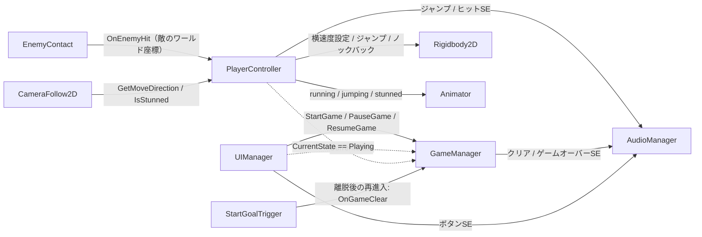
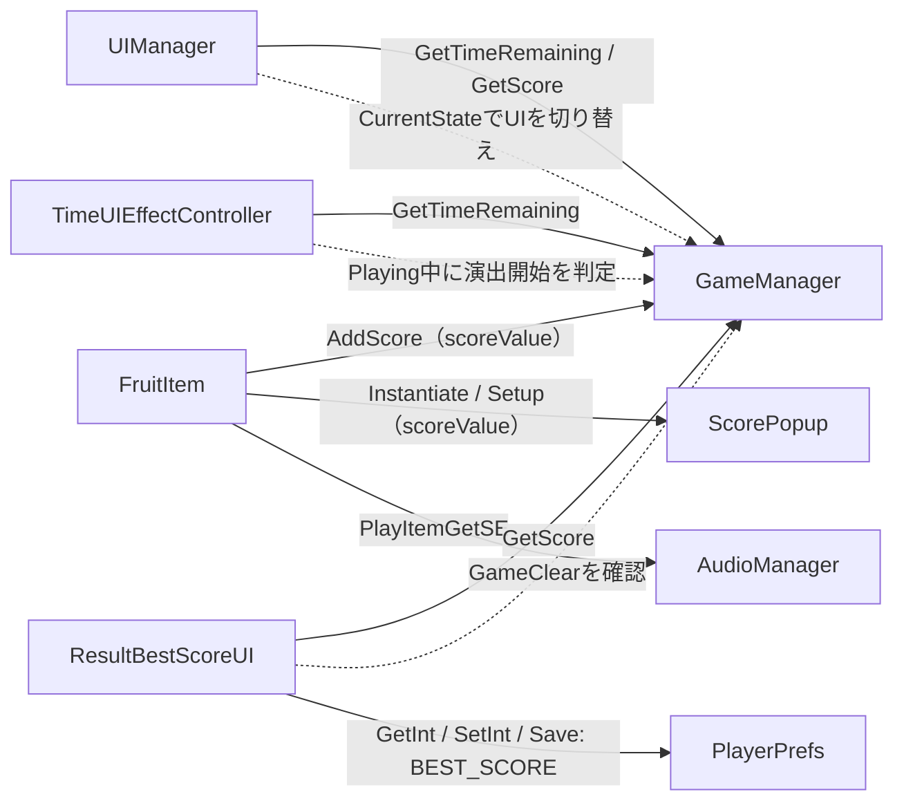
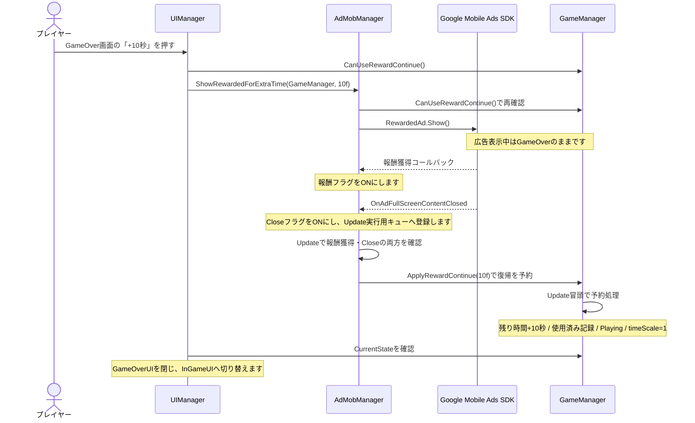

# Fruit Dush

UnityとC#で個人開発した、縦画面の2Dオートランアクションゲームです。
フルーツを集めながら移動し、制限時間内にスタート地点へ戻ることを目指します。
短押しのジャンプと長押し後の方向転換を使い分け、敵との接触を避けながらスコアを獲得します。

## ゲームをプレイする

| 配信先 | 公開URL |
| --- | --- |
| WebGL版（GitHub Pages） | <!-- https://minori-gh.github.io/FruitDush/ --> |
| iOS版（App Store） | <!-- https://apps.apple.com/jp/app/フルーツダッシュ-1分で持ち帰れ-60秒ランゲーム/id6772475963 --> |

## 開発環境・公開状況

| 項目 | 内容 |
| --- | --- |
| ゲームエンジン | Unity 6 |
| 開発言語 | C# |
| 開発体制 | 個人開発 |
| 使用技術 | Rigidbody2D、Animator、uGUI、TextMeshPro、Unity Localization、Google Mobile Ads SDK |
| 対応プラットフォーム | iOS |
| 開発状況 | AppStore公開中

## 主な実装機能

- **オートランと押下時間による操作切り替え**：初期方向は右へ移動します。指またはマウスを離したときに、押下時間が0.2秒未満なら接地中のみジャンプし、0.2秒以上なら移動方向と見た目を反転します。
- **敵の巡回・接触リアクション**：敵は初期位置を中心に左右へ往復します。接触時はプレイヤーにノックバックを与え、0.5秒のスタンと1秒の無敵時間をコルーチンで管理します。
- **アイテム取得と得点演出**：Triggerでフルーツ取得を検知し、設定された得点を加算します。取得位置に `+スコア` のPrefabを生成し、上昇させて1秒後に削除します。
- **制限時間と帰還によるクリア判定**：60秒のタイマーは `Playing` 中だけ減少します。スタート地点のTriggerから一度出て再び入るとクリアし、時間切れではゲームオーバーになります。
- **状態に応じたUI・時間演出**：開始・プレイ中・ポーズ・ゲームオーバー・クリアの各UIを切り替えます。残り30秒で時計を拡大・縮小し、残り5秒からはタイマーを参照したカウントダウンを表示します。
- **ベストスコア保存**：クリア時のみ現在スコアと保存値を比較し、記録更新時に `NEW RECORD` を表示します。保存には `PlayerPrefs` を使用します。
- **広告とリトライ**：3画面のRetryボタンを共通処理に集約し、押下回数5回ごとにインタースティシャル広告の表示を要求します。リワード広告は報酬獲得と広告Closeの両方を確認してから、1プレイ1回だけ10秒追加して復帰します。
- **カメラ・アニメーション・SE・フォント切り替え**：進行方向を参照した前方追従、AnimatorのBoolパラメータ更新、SE別の音量調整、Localeに応じたTextMeshProフォント切り替えを実装しています。

## システム構成・クラス間の関係

### ゲーム進行とプレイヤー制御

図の実線矢印はメソッド呼び出し・API操作を、破線矢印は状態やプロパティの参照を表します。
矢印は、呼び出す側・参照する側から対象へ向けています。Unityの `Update` やTriggerイベントによる実行は、本文で補足しています。



`GameManager` は `Start / Playing / Pause / GameOver / GameClear` の状態、スコア、残り時間を保持します。`PlayerController` は状態を読み、`Playing` 中かつスタンしていない場合に入力とオートランを処理します。`GameManager` からプレイヤーへ直接移動命令を送る構成ではありません。

`UIManager` も `CurrentState` を監視し、初回または状態変化時にパネルを切り替えます。`Pause` と `GameOver` ではプレイ中UIも表示し、`GameClear` ではクリアUIのみを表示します。時間停止・再開は主に `GameManager` が行い、`UIManager` にも `Playing` 中の `timeScale == 0` を1へ戻す補正があります。

`EnemyMove` はTransformによる巡回移動を担当し、`EnemyContact` を直接呼び出しません。接触通知はUnityのTriggerイベントから発生し、ノックバック・スタン・無敵の処理は `PlayerController` が担当します。

### アイテム取得・表示・保存



`FruitItem` は `Player` タグとの接触を検知し、`scoreValue` を `GameManager` と `ScorePopup.Setup()` へ渡してから自身を削除します。得点の設定目安はスクリプトのHeaderにバナナ5点・リンゴ10点・スイカ15点とあり、取得処理自体は種類別に分岐せず、共通の整数値を扱います。フルーツ取得では時間を加算しません。

`UIManager` はGetterでスコア・残り時間を取得してTextMeshProへ反映します。`ResultBestScoreUI` は `OnEnable` 時にクリア状態なら保存処理を実行し、未到達ならコルーチンで待機します。`GameManager` や `UIManager` から、このクラスの保存メソッドを直接呼ぶ実装ではありません。

### 広告終了後の復帰



図は報酬獲得がCloseより先に通知される例です。コードでは両方のコールバックから条件を確認します。`AdMobManager` はUnity操作を伴う処理をキュー経由で実行し、`GameManager` は復帰予約を `Update` 冒頭で受け取ります。プレイヤーは `Playing` への変化を自身で参照して操作を再開します。

インタースティシャル広告は別の流れです。`UIManager.OnClickRetry()` が `RETRY_COUNT` を保存して表示間隔を判定し、該当回のみ `ShowInterstitial(ReloadCurrentSceneToStart)` を呼びます。広告Close・表示失敗時はコールバックでシーンを再読込し、広告未準備時や通常回も再読込へ進みます。

### スクリプト一覧

「関連先」は実際のメソッド呼び出し、状態参照、Unity・外部APIの利用先を記載しています。

| スクリプト | 主な役割 | 関連先・受け渡し |
| --- | --- | --- |
| [GameManager.cs](Scripts/GameManager.cs) | 状態・残り時間・スコアと、リワード復帰予約を管理します。 | `UIManager`・`PlayerController` などが状態を参照します。`FruitItem` から加点、`StartGoalTrigger` からクリア通知、`AdMobManager` から復帰予約を受けます。 |
| [PlayerController.cs](Scripts/PlayerController.cs) | 押下時間の判定、オートラン、接地・ジャンプ、被弾、Animator更新を担当します。 | `GameManager.CurrentState`、`EnemyContact` からの被弾通知、`AudioManager`、Rigidbody2D、Animatorと連携します。 |
| [CameraFollow2D.cs](Scripts/CameraFollow2D.cs) | X方向の前方追従とスタン中の即時追従を担当します。 | 対象Transformと `PlayerController.GetMoveDirection()`・`IsStunned()` を参照します。 |
| [EnemyMove.cs](Scripts/EnemyMove.cs) | 初期位置を基準に往復し、見た目を左右反転します。 | Transformを操作します。他の独自クラスは参照しません。 |
| [EnemyContact.cs](Scripts/EnemyContact.cs) | Trigger接触をプレイヤーへ通知します。 | `PlayerController.OnEnemyHit()` に敵のワールド座標を渡します。 |
| [FruitItem.cs](Scripts/FruitItem.cs) | フルーツ取得、加点通知、SE・ポップアップ生成を担当します。 | `GameManager.AddScore()`、`ScorePopup.Setup()`、`AudioManager.PlayItemGetSE()` を呼びます。 |
| [ScorePopup.cs](Scripts/ScorePopup.cs) | `+スコア` の設定、上昇移動、寿命後の削除を担当します。 | `FruitItem` から整数スコアを受け取り、TMPテキストへ表示します。 |
| [StartGoalTrigger.cs](Scripts/StartGoalTrigger.cs) | スタート地点からの離脱を記録し、帰還を判定します。 | `Player` タグを確認し、再進入時に `GameManager.OnGameClear()` を呼びます。 |
| [UIManager.cs](Scripts/UIManager.cs) | UI切り替え、得点・時間表示、各ボタンと広告タイミングを管理します。 | `GameManager`、`AdMobManager`、`AudioManager`、PlayerPrefs、SceneManagerと連携します。 |
| [TimeUIEffectController.cs](Scripts/TimeUIEffectController.cs) | 残り時間に応じた時計ポップ・カウントダウン演出を担当します。 | `GameManager.CurrentState`・`GetTimeRemaining()` を参照し、RectTransformとTMPテキストを操作します。 |
| [ResultBestScoreUI.cs](Scripts/ResultBestScoreUI.cs) | クリア時のベストスコア比較・保存・記録更新表示を担当します。 | `GameManager.GetScore()` とPlayerPrefsの `BEST_SCORE` を使用します。 |
| [LocalizedTMPFontSwitcher.cs](Scripts/LocalizedTMPFontSwitcher.cs) | 対象テキストのフォントをLocale別に切り替えます。 | `LocalizationSettings.SelectedLocaleChanged` を購読し、同一GameObjectのTextMeshProUGUIに適用します。 |
| [AudioManager.cs](Scripts/AudioManager.cs) | SEの再生窓口と、SEごとの音量を管理します。 | 各クラスの用途別再生メソッドから、1つのAudioSourceの `PlayOneShot()` を呼びます。 |
| [AdManager.cs](Scripts/AdManager.cs) | 広告の初期化・ロード・表示・破棄・コールバック処理を担当します。定義クラス名は `AdMobManager` です。 | `UIManager` から表示要求を受け、Google Mobile Ads SDKと `GameManager.ApplyRewardContinue()` に連携します。 |

## 技術的な工夫

### 1. 状態を参照するゲーム進行とUI更新

`GameManager` のenumと `CurrentState` を共通の判断材料とし、タイマー、プレイヤー操作、画面表示を連動させています。`UIManager` は前回の状態を保持してパネル切り替えを状態変化時に限定し、数値表示の更新とは処理を分けています。タイムアップはコルーチンで1フレーム待って確定し、重複開始をフラグで抑制しています。

関連：[GameManager.cs](Scripts/GameManager.cs)、[UIManager.cs](Scripts/UIManager.cs)、[PlayerController.cs](Scripts/PlayerController.cs)です。

### 2. 入力・物理更新の分離と、接触通知の役割分担

入力は `Update` で押し始めと離した時刻の差を測り、横方向の速度設定は `FixedUpdate` で行います。ジャンプは上方向速度をリセットしてからImpulseを加えます。敵側は接触と座標の通知に限定し、プレイヤー側が無敵判定、ノックバック、スタンを処理する構成です。スタン中はオートランによる速度の上書きを止め、接地中のみ横速度を減衰させています。

関連：[PlayerController.cs](Scripts/PlayerController.cs)、[EnemyContact.cs](Scripts/EnemyContact.cs)です。

### 3. 移動意思と物理速度を分けたカメラ追従

通常時の前方オフセットは物理速度ではなく `GetMoveDirection()` から求めるため、ノックバックで速度が逆転しても前方を示す向きは反転しません。`LateUpdate` で指数式による補間係数を計算してLerpし、スタン中は向きを保持したまま即時追従へ切り替えます。公開コードではスタン中も前方オフセットを維持し、Yは初期値、Zは-10に固定しています。

関連：[CameraFollow2D.cs](Scripts/CameraFollow2D.cs)、[PlayerController.cs](Scripts/PlayerController.cs)です。

### 4. 広告イベントとゲーム復帰処理の分離

リワードでは「報酬獲得」と「Close」を別フラグで記録し、両条件を満たしてから復帰を予約します。広告初期化・ロード・イベントに伴う処理を `Queue<Action>` に登録し、キューの追加・取り出しを `lock` で保護して `AdMobManager.Update` で実行します。さらに `GameManager` 側でも予約を `lock` 付きで受け渡し、`Update` で時間加算と `Time.timeScale` の復帰を行います。

広告の管理とRetryの表示頻度判定は分かれており、頻度と回数保存は `UIManager` が担当します。`AdMobManager` はSingletonと `DontDestroyOnLoad` で維持し、広告の再ロード、終了時の破棄、iOS・AndroidのID切り替え、初期化前のテスト端末設定も実装しています。

関連：[AdManager.cs](Scripts/AdManager.cs)、[GameManager.cs](Scripts/GameManager.cs)、[UIManager.cs](Scripts/UIManager.cs)です。

### 5. Locale変更に応じた、テキスト単位のフォント切り替え

`LocalizedTMPFontSwitcher` は全テキストを検索せず、同一GameObjectのTextMeshProUGUIを取得します。有効化時に現在のLocaleを適用し、言語変更イベントを購読、無効化時に解除します。日本語・英語・簡体字・繁体字・韓国語を分岐し、それ以外や個別フォント未設定時には共通フォントを選びます。同じフォントなら再設定を省略します。

関連：[LocalizedTMPFontSwitcher.cs](Scripts/LocalizedTMPFontSwitcher.cs)です。`docs/StreamingAssets/aa/WebGL/` には、上記言語に加えてフランス語・ドイツ語・スペイン語・ポルトガル語・ロシア語・ベトナム語のLocalization関連バンドルも含まれます。翻訳内容の網羅性は未確認です。

### 6. スコアデータと表示演出の分離

得点本体は `GameManager`、取得時の一時表示は `ScorePopup`、クリア時の記録保存は `ResultBestScoreUI` が担当します。ベストスコアは未保存時を0として扱い、厳密に上回った場合のみ更新し、保存処理で `PlayerPrefs.Save()` を呼びます。

時間演出は別クラスに分け、独自のタイマーを進めず `GetTimeRemaining()` から表示値を求めます。残り秒数は切り上げ、カウントダウンの文字列更新は整数値が変わったときだけ行います。30秒・5秒の演出開始には一度だけ発火するフラグを使用しています。

関連：[FruitItem.cs](Scripts/FruitItem.cs)、[ScorePopup.cs](Scripts/ScorePopup.cs)、[ResultBestScoreUI.cs](Scripts/ResultBestScoreUI.cs)、[TimeUIEffectController.cs](Scripts/TimeUIEffectController.cs)です。

## リポジトリについて

```text
FruitDush/
├── README.md
├── Scripts/                     C#スクリプト14本と各.metaファイルです
├── docs/                        WebGLビルドの配置先です
│   ├── index.html               起動ページ・ビルド読込設定です
│   ├── Build/                   .loader.js / .framework.js / .data / .wasmです
│   ├── StreamingAssets/aa/      Addressablesカタログ・設定・バンドルです
│   │   └── WebGL/              Localization関連バンドルを含みます
│   └── TemplateData/            WebGLテンプレートのCSS・画像です
├── .gitattributes
└── .gitignore
```

`docs/` は技術文書集ではなく、WebGLの実行用出力です。GitHub Pagesの公開URLは上部へ追記する想定です。
